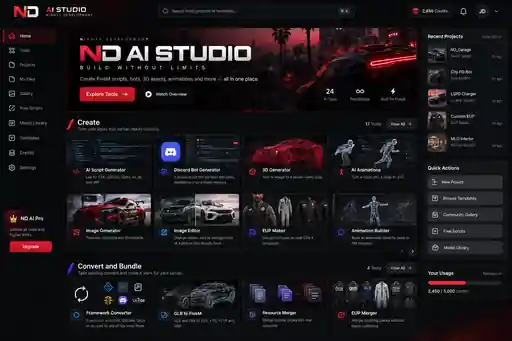

# ND AI Studio

Nightz Development's original FiveM creation workspace. Intended domain: `ai.nightz.dev`.

## Release 0.1: frontend foundation

This release contains a runnable, dependency-free web frontend, not a connected AI platform. All 24 generation, conversion and browsing tools remain explicitly planned and disabled.

Available now:

- Original responsive dark interface with ND red accents and mobile navigation.
- Searchable 24-tool catalog, category filtering and tool detail dialogs.
- Browser-local project briefs with creation, editing, deletion and JSON export.
- Framework selection for coding briefs, without treating ox_lib as a framework.
- A readiness view that distinguishes the frontend from unimplemented services.
- Node build/preview tooling, catalog/storage tests and deployment files for `ai.nightz.dev`.

Not implemented: authentication, server-side project persistence, AI providers, job queues, sandbox workers, generated resources, asset converters, billing or community publishing. No generated files, build logs, progress, credits or user activity are simulated. A saved brief is requirements data, not a generated project.

## Run locally

Use Node.js 22 or newer. There are no third-party runtime or build dependencies and no install step.

```bash
npm test
npm run build
npm start
```

The preview listens only on `http://127.0.0.1:3080`. Set `PORT` to change the port. Production serves the built `dist` directory, never the repository root. See [deployment instructions](deploy/README.md).

## Project briefs

Briefs stay in this browser under `nd-ai-studio.briefs.v1`. They are not synced to an account or the server. Export important briefs before clearing browser data or changing devices. Maximum: 100 briefs, 80 characters per name and 12,000 characters per requirements field.

Do not store credentials or confidential customer material in briefs. The frontend does not contact an AI provider. Invalid stored data blocks writes rather than silently deleting it. Local storage is not an account database or a transactional multi-user system.

## Source layout

- `web/`: semantic HTML, modular JavaScript and custom CSS. No UI framework or copied templates.
- `config/tools.json`: authoritative tool catalog and availability flags.
- `scripts/`: build and localhost-only preview server.
- `tests/`: catalog, filtering and storage validation tests.
- `deploy/`: Caddy site block and an asset-only release publisher.
- `docs/`: product scope, original design system, proposed backend and roadmap.
- `assets/design/`: initial AI-generated visual reference. It is not a product screenshot.

The backend architecture remains a proposal. This frontend does not create a security boundary for future execution workers.

## Verification

Six Node tests, JavaScript syntax checks and Bash syntax checks passed during preparation. The production build completed. Browser end-to-end checks and live deployment have not been verified in this environment. Do not treat the presence of a deployment config as proof that DNS, TLS or the server is configured.

## Design reference



This concept image contains illustrative projects, credit balances and controls that are not implemented. The actual frontend uses text, CSS and semantic controls rather than rendering the image as the application.

## Security and licensing

Never commit API keys, Discord tokens, SSH credentials, customer uploads or production databases. Provider calls and generated-code execution must be implemented behind authenticated server-side services with isolation and ownership checks.

No open-source license has been selected. Do not redistribute third-party assets without permission. Preserve source, author, license and attribution requirements for future imports.
